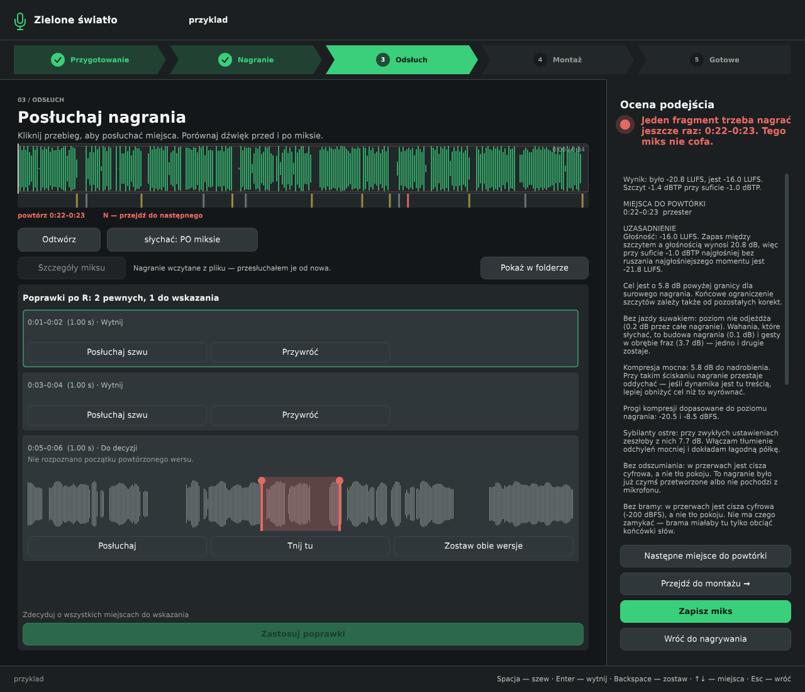

# Odsłuch: poprawki po R (zadanie #44)



[Małe okno 960 × 640](panel-small.png). Lista jest przewijana; na małym ekranie ogólny przebieg ustępuje miejsca przebiegowi konkretnego cięcia. Kolory, fonty i przyciski pochodzą z Look.h / UiRules.h.

Panel pokazuje zapisane propozycje. „Przywróć” i „Wytnij” przełączają pewne cięcia. W niepewnych przeciąga się czerwone znaczniki; w odległości 12 pikseli przyciągają się do punktu `max(pauza.od, pauza.do − 0,15 s)` znalezionego przez CutFinder na pokazanym fragmencie. Przesunięcie zapisuje szkic jako Pending, a „Tnij tu” zatwierdza granice. „Zostaw obie wersje” odrzuca propozycję. Każda zmiana zapisuje TSV; błąd zapisu cofa decyzję i pokazuje komunikat.

„Posłuchaj szwu” / „Posłuchaj” składa wyłącznie fragment odsłuchowy w pamięci z 3 sekund po obu stronach cięcia. Odtwarza go istniejący Audition, po ewentualnym przeliczeniu częstotliwości do urządzenia. WAV pozostaje nietknięty. Spacja odsłuchuje wybraną propozycję; ↑↓ zmieniają wybór; Enter zatwierdza; Backspace odrzuca.

„Zastosuj poprawki” jest zablokowane, dopóki istnieje Pending. Cięcie wykonuje wyłącznie applyCutList; po sukcesie load ponownie czyta WAV i liczy ocenę oraz miks. Komunikat podaje liczbę fragmentów, czas i ostrzeżenie o zmianie tła. Gdy wszystkie propozycje są odrzucone, WAV pozostaje bez zmian, a pełne nagranie i TSV są archiwizowane w „surowe”. Ręczny montaż jest dostępny po zakończeniu decyzji, aby nie rozjechać czasów listy.

## Sprawdzenie

- `Tests/ci.sh`: wszystkie testy przeszły; tabela w [testy.md](testy.md).
- `Tests/wszystko.sh`: zakończone „wszystko przeszlo”.
- Kompilacja aplikacji i CieciaPanelTest z JUCE 7.0.12 na Linuksie przeszła.
- Test rzeczywistych przycisków i zdarzeń klawiatury/myszy: [ui-test.txt](ui-test.txt). Wywołania onClick i MouseEvent są automatyczne, bez klikania przez człowieka. Sprawdzono Przywróć → Rejected w TSV, Wytnij → Accepted, ↓↓ + Spacja → trzeci fragment, Enter → odblokowanie zastosowania, przeciągnięcie → pauza + Pending, Backspace → Rejected, ponowne wczytanie → zachowane decyzje, błąd zapisu → cofnięta decyzja. Porównanie WAV bajt po bajcie potwierdziło brak zmian przed zastosowaniem; kliknięcie zastosowania wycięło zaakceptowane zakresy i zarchiwizowało surowe z listą.
- Zrzuty `--preview-ui` obejrzane w dużym i małym oknie. Podgląd tworzy kopię WAV w katalogu tymczasowym i nie dopisuje przykładowej listy do pliku użytkownika.
- Odsłuch na fizycznej karcie oraz kompilacja Windows nie były sprawdzane w tym środowisku.

Odtworzenie testu panelu (na Linuksie potrzebny działający DISPLAY, np. Xvfb):

```sh
cmake --build build --target ZieloneSwiatlo CieciaPanelTest -j 2
DISPLAY=:98 build/CieciaPanelTest_artefacts/Release/CieciaPanelTest
DISPLAY=:98 "build/ZieloneSwiatlo_artefacts/Release/Zielone swiatlo" --preview-ui panel.png review-ciecia /tmp/mowa/mowa-czysta.wav
DISPLAY=:98 "build/ZieloneSwiatlo_artefacts/Release/Zielone swiatlo" --preview-ui panel-small.png review-ciecia-small /tmp/mowa/mowa-czysta.wav
```
