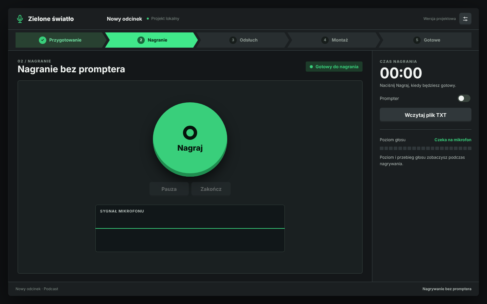
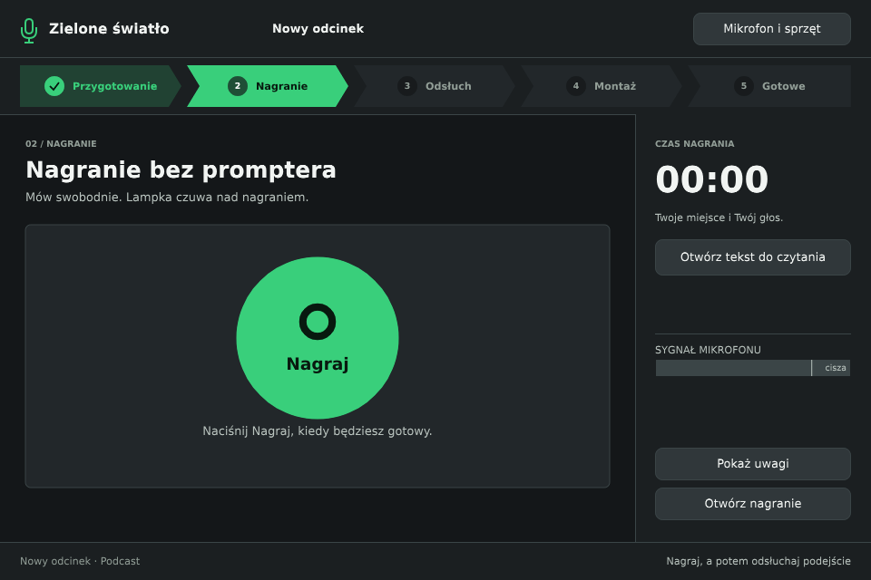
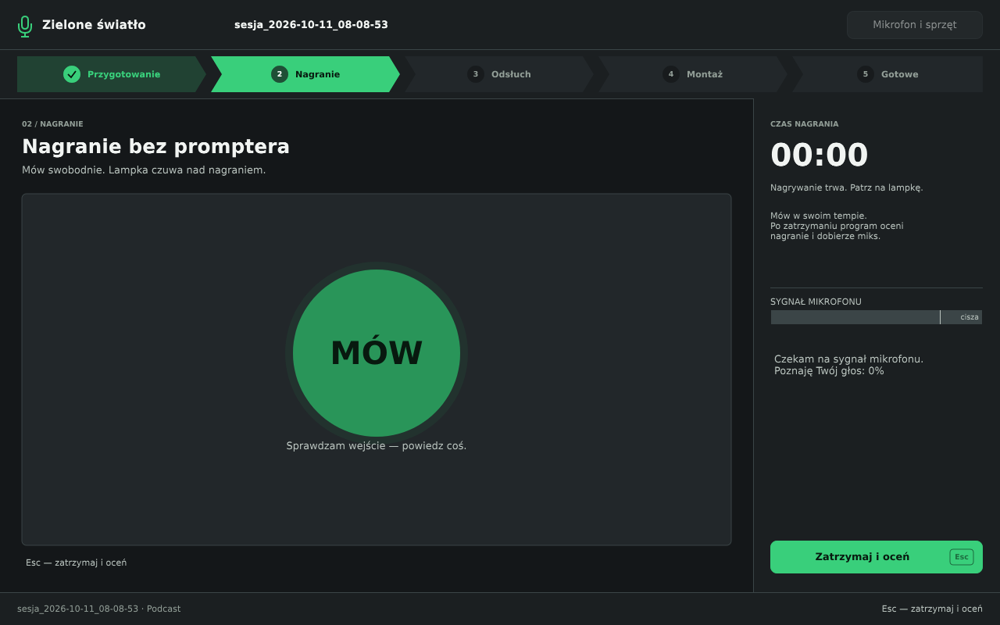
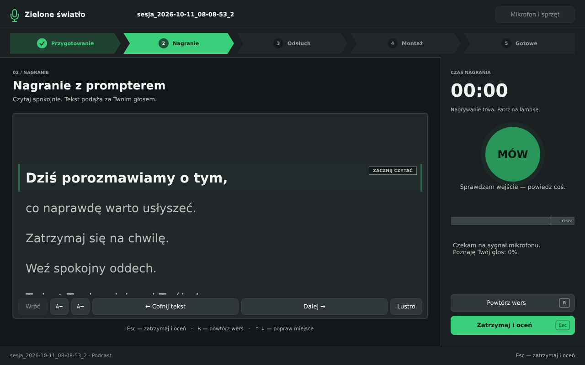

# Wygląd 3.1 — fundament i nagrywanie

Zrzuty z `--preview-ui`, wykonane natywnie na Linuksie pod Xvfb. Tutaj systemowym
zamiennikiem Segoe UI jest DejaVu Sans; wygląd i łamanie tekstu z Segoe UI trzeba
jeszcze sprawdzić na Windowsie.

| Wzór `ekran-2.png` | Program przed nagraniem, minimum 960 × 640 |
|---|---|
|  |  |

Z prototypu pochodzą paleta, krój na Windowsie, nagłówek z mikrofonem, pięć kroków
ze strzałkami i ptaszkiem, podział treść/panel boczny, stopka oraz okrągły przycisk
„Nagraj”. W trakcie nagrania jego miejsce zajmuje lampka z napisem „MÓW”, „POWTÓRZ”,
„POPRAW” lub „STOP”. Przycisk „Zatrzymaj i oceń” prowadzi do istniejącej oceny.
Nie ma pauzy ani suwaka tempa: prompter nadal podąża za głosem.

## Nagrywanie — 1280 × 800



## Prompter podczas nagrania — 1280 × 800



Lampka, czas i przyciski są w panelu bocznym. Esc zatrzymuje i ocenia, R powtarza
wers także po przeniesieniu fokusu na przycisk. Narzędzia wielkości tekstu,
przesunięcia i lustra pozostają dostępne podczas nagrania.

## Weryfikacja

- Kompilacja aplikacji z JUCE 7.0.12: przeszła.
- `bash Tests/ci.sh`: kod 0; [pełna tabela](testy.md). `wyglad-test`: 29 sprawdzeń OK.
- `bash Tests/wszystko.sh`: zatrzymuje się na `restore-test`, zapisanym już
  w `Tests/znane-bledy.txt`; CI sprawdziło również resztę zestawu.
- Dodatkowa próba na rzeczywistych komponentach JUCE pod Xvfb: okrągły przycisk
  przed nagraniem, prompter i lampka w 960 × 640, R w komponencie nadrzędnym,
  zatrzymanie przez Esc oraz otwarcie ekranu oceny — przeszły.
- Obejrzane również `recording-small`, `prompter-rec-small`, `settings` i `prompter`.
  Przyrostek `-small` pozwala teraz robić podgląd trybu w oknie 960 × 640.
- Zachowane CRLF w plikach, które je miały. DSP, Recorder i VoskEngine bez zmian.

Zrzuty nie sprawdzają żywego mikrofonu, zmian lampki, przewijania za prawdziwym
głosem ani odsłuchu. Nie sprawdzono ich na Windowsie. Wnętrza ekranów przygotowania,
kreatora i odsłuchu pozostają do następnych kroków zadania 3.

Odtworzenie zrzutów (po zbudowaniu programu):

```bash
for mode in recording prompter-rec small; do
  xvfb-run -a "build/ZieloneSwiatlo_artefacts/Release/Zielone swiatlo" \
    --preview-ui "Docs/projekt/wyglad-1/$mode.png" "$mode"
done
```
